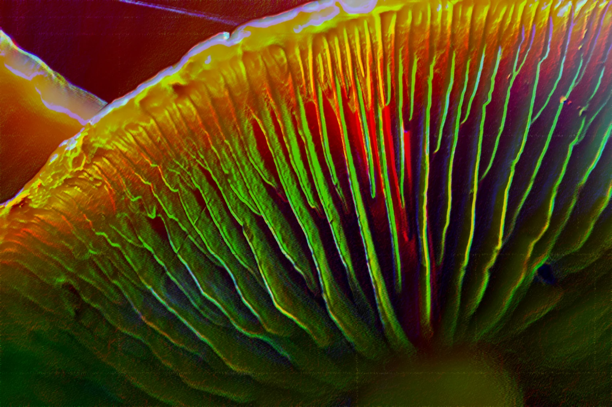

# Spora-Archive

## 📜 Description

La constitution d'une mycotheque est une étape importante pour tout myciculteur avancé. Parmi les méthodes de conservation des spores, les empreintes demeurent la meilleure technique, offrant une pérénité, une adaptabilité et une mobilité singuliéres.  
Le projet Spora-Archive offre une proposition compléte, clef en main, de standardisation d'une mycothéque d'empreintes de spores sécurisée, transportable (par la taillle de boite de deck MagicTheGathering) et resiliente.  
Cette initiative ici livrée en open-source permettra à tous de pouvoir s'en saisir, la déployer ou l'optimiser.  
Car le projet Spora-Archive permet une mise en place simple et peu onéreuse (quelques impressions et quelques éléments basiques du jeu de carte MagicTheGathering).

Enjoy ;)

## 🗂️ Overview of the structure

- **[DIR]**/Templates/ : Contient les modèles des IDcards en SVG et png pret à être imprimés.
- **[DIR]**/Tutorials/ : Répertoire où se trouve les tutoriels (pdf et md), reprenant étapes par étapes la création d'une mycothéque Spora-Archive Compliance.
- **[DIR]**/Ressources/ : Des QR-Codes et des fiches pour les especes les plus communes (liste non exhaustive).
- **[FILE]**/README.md : Ce fichier, contenant la description du projet.
- **[FILE]**/Spora-Archive.webp : Image d'illustration du projet (Credit : [Sander-Mathlener](https://unsplash.com/fr/photos/fleur-jaune-SIZd5QF5a7M))
- **[FILE]**/LICENSE : Licence du projet, sous licence MIT.

## 🍄⚡ Tutoriel express

Quelques étapes résumées du tutoriel complet consultable dans le répertoire [Tutorials](Tutorials/).

### Etape 0 : Le matériel
- Des rectangles de papier aluminium de 11cmx8cm max
- Alcool à 70° ou 90° (alcool isopropylique ou éthanol), ainsi que des coupelles en verre ou un verre d'eau.
- Les IDcards Spora-Archive de votre choix imprimées.
- Des gants en nitrile ou latex (pour la manipulation des empreintes de spores)
- Proteges-cartes MagicTheGathering (des [UltraPro](https://www.philibertnet.com/fr/ultra-pro/161521-100-deck-protector-noir-regular-size-074427826918.html) suffisent, pour plus de robustesse des DragonShield reste envisageables)
- Une boite de deck MagicTheGathering de votre choix (par exemple une [Deckbox assez jolie, solide et resistante dans le temps](https://www.philibertnet.com/fr/ultimate-guard/183090-magic-the-gathering-reality-fracture-sidewinder-100-2100001416539.html), ou une [plus modeste mais tout aussi solide](https://www.philibertnet.com/fr/gamegenic/180795-magic-the-gathering-the-hobbit-soft-dynacrate-100-xl-4251715425664.html))

### Etape 1 : La création de l'empreinte

0) Manipulations à effectuées de préférence avec des gants ou mains lavées et desinfectées afin d'eviter les contaminations.
1) Poser la feuille de papier aluminium sur une surface plane et propre, et passer un coup d'alcool dessus pour la désinfecter.
2) Déposer le champignon sur la feuille d'aluminium, et le recouvrir d'un verre ou d'une coupelle en verre.
3) Laisser le champignon reposer pendant 12 à 24h, afin que les spores se déposent sur la feuille d'aluminium.

### Etape 2 : Conditionnement de l'empreinte

1) Retirer le verre ou la coupelle, et récupérer la feuille d'aluminium avec l'empreinte de spores.
2) Plier la feuille d'aluminium en deux pour protéger l'empreinte, et la placer dans l'IDcards Spora-Archive correspondante.
3) Glisser l'IDcards dans le protège-carte MagicTheGathering, et la ranger dans la boite de deck MagicTheGathering.

## 🚦 Types : Le code couleur

Dans le coin gauche de chaque IDCards il est présent (à coté du nom de l'espece) une illustration d'un champignon colorée, qui, selon sa couleur, permet de savoir rapidement à quel type d'empreinte on a affaire.  
La nomenclature de ces types par couleurs est établie comme suit :
- ⬛ Noir : Mortel/Toxique
- 🟥 Rouge : Psychedelique
- 🟩 Vert : Comestible
- 🟦 Bleu : Médicinal

## 📝 License

Ce projet est sous licence MIT. Vous pouvez consulter le fichier [LICENSE](LICENSE) pour plus de détails.

## 🔥 Remerciements
Le porteur du projet remercie chaleureusement [Denis SALEM](https://denissalem.ovh/) ainsi que [Geoffrey DORNE](https://www.geoffreydorne.com/) pour leur soutien et leurs conseils précieux dans le développement de Spora-Archive.