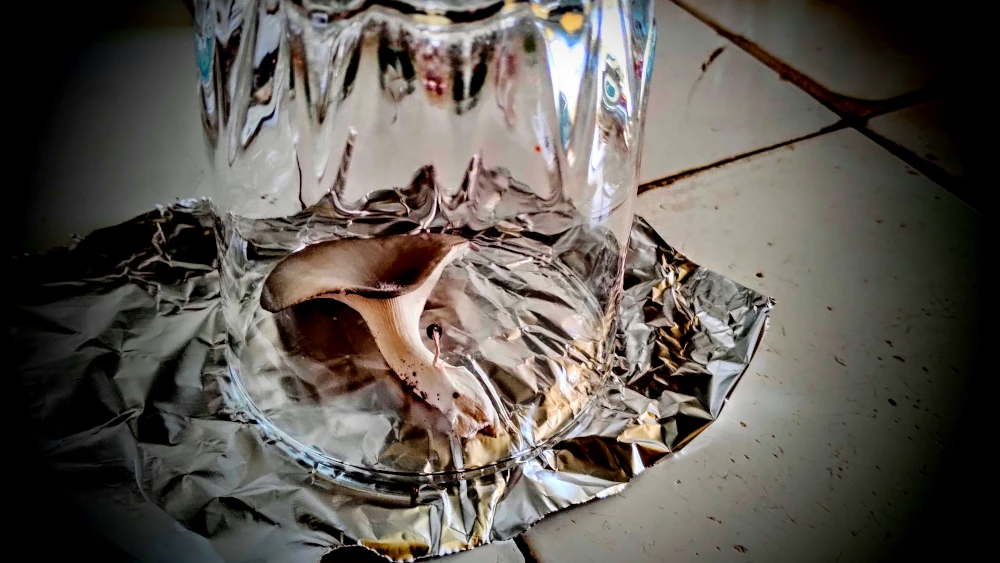
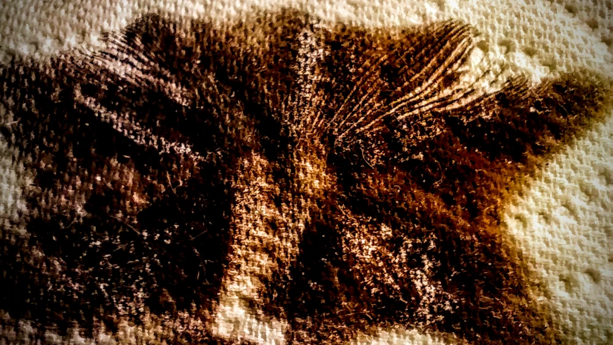

# Tutoriel pour la mise en place d'une Spora-Archive

## 📜 Description

Ce tutoriel complet reprend les étapes de la mise en place d'une mycothéque Spora-Archive Compliance, en détaillant chaque étape et en fournissant des conseils pour garantir la sécurité et la pérennité de vos empreintes de spores.

## 🧰 Materiel nécessaire

- Des rectangles de papier aluminium de 11cmx8cm max
- Alcool à 70° ou 90° (alcool isopropylique ou éthanol), ainsi que des coupelles en verre ou un verre d'eau.
- Du materiel d'impression pour les IDcards Spora-Archive (imprimante, papier, etc.)
- Des gants en nitrile ou latex (pour la manipulation des empreintes de spores)
- Proteges-cartes MagicTheGathering (des [UltraPro](https://www.philibertnet.com/fr/ultra-pro/161521-100-deck-protector-noir-regular-size-074427826918.html) suffisent, pour plus de robustesse des DragonShield reste envisageables)
- Une boite de deck MagicTheGathering de votre choix (par exemple une [Deckbox assez jolie, solide et resistante dans le temps](https://www.philibertnet.com/fr/ultimate-guard/183090-magic-the-gathering-reality-fracture-sidewinder-100-2100001416539.html), ou une [plus modeste mais tout aussi solide](https://www.philibertnet.com/fr/gamegenic/180795-magic-the-gathering-the-hobbit-soft-dynacrate-100-xl-4251715425664.html))

## 🍄 Créer l'empreinte de spores

0) Manipulations à effectuées de préférence avec des gants ou mains lavées et desinfectées afin d'eviter les contaminations.
1) Poser la feuille de papier aluminium sur une surface plane et propre, et passer un coup d'alcool dessus pour la désinfecter.
2) Déposer le champignon sur la feuille d'aluminium, et le recouvrir d'un verre ou d'une coupelle en verre. Il peut être utile d'humidifier le dessus du champignon afin de favoriser le dépôt des spores, mais attention à ne pas trop mouiller le champignon pour éviter la formation de moisissures.
3) Laisser le champignon reposer pendant 12 à 24h, afin que les spores se déposent sur la feuille d'aluminium.

## 🖨️ Editer l'IDCard de la souche

Pendant que l'empreinte se forme, vous pouvez éditer l'IDCard correspondante à la souche de champignon que vous avez utilisé.  
De là, deux options s'offrent à vous : soit vous imprimez directement une IDCard existante dans le répertoire [Templates](../Templates/) pour les espèces les plus communes (disponibles au format PDF), soit vous pouvez créer votre propre IDCard en éditant le fichier SVG correspondant à l'espèce que vous souhaitez ajouter à votre mycothéque.  
Une fois imprimée et découpée, vous pouvez plier les lignes de pliage.

## 🧾 Conditionner l'empreinte de spores

1) Une fois les heures écoulées, retirer le verre ou la coupelle, et récupérer la feuille d'aluminium avec l'empreinte de spores.  
L'empreinte devrait ressembler à une fine poussière noire ou colorée sur la feuille d'aluminium, comme illustré ci-dessous.

2) Plier la feuille d'aluminium en deux pour protéger l'empreinte, et la placer dans l'IDCard Spora-Archive correspondante.
3) Après s'etre assuré que l'empreinte est bien protégée dans l'IDCard, glisser l'IDCard dans le protège-carte MagicTheGathering, comme illustré ci-dessous.

4) Enfin, ranger le protège-carte dans la boite de deck MagicTheGathering.

## 🚦 Types : Le code couleur

Dans le coin gauche de chaque IDCards il est présent (à coté du nom de l'espece) une illustration d'un champignon colorée, qui, selon sa couleur, permet de savoir rapidement à quel type d'empreinte on a affaire.  
La nomenclature de ces types par couleurs est établie comme suit :
- ⬛ Noir : Mortel/Toxique
- 🟥 Rouge : Psychedelique
- 🟩 Vert : Comestible
- 🟦 Bleu : Médicinal

## ⚠️ Conservation et sécurité

Pour garantir la pérennité de vos empreintes de spores, il est recommandé de stocker la boite de deck MagicTheGathering dans un endroit frais et sec, à l'abri de la lumière directe du soleil.

Il est également conseillé de manipuler les empreintes avec précaution, en utilisant des gants et en évitant tout contact direct avec la peau.

## 📚 Ressources supplémentaires

### 🔗 Netographie

- [Guide Pratique de La Mycosphere](https://youtu.be/MONUE97meYM) : Un guide complet sur la confection d'empreintes de spores.
- [Tutoriel de Zamnesia](https://www.zamnesia.fr/blog-comment-prendre-des-empreintes-de-spore-propres-n347) : Un tutoriel détaillé sur la prise d'empreintes de spores halucinogénes, applicable à toutes les espèces de champignons.

### 📺 Ressources Videos

- [Tutoriel video pour la création d'une empreinte de spores](https://youtu.be/URHWiiZDwmU)
- [Tutoriel pour l'utilisation d'une sporée](https://youtu.be/9Vvwd0ZaH6E)

### 📖 Bibliographie

- [Les champignons vont sauver le monde](https://www.amazon.fr/champignons-vont-sauver-monde-insoup%C3%A7onn%C3%A9s/dp/2017161403) : Un ouvrage de Paul Stamets sur les champignons et leur rôle dans l'écologie et la médecine.
- [Registre de Myciculture](https://www.amazon.fr/Registre-Myciculture-Champignons-Colonisation-Fructification/dp/B0H6LGQX6W) : Culture de Champignons à Domicile: Suivi des Souches, Substrats, Colonisation, Fructification et Récoltes — Journal de bord du Myciculteur
- [Cultiver des champignons chez soi: Le guide pratique pour débuter en myciculture](https://www.amazon.fr/Cultiver-champignons-chez-soi-myciculture-ebook/dp/B0HH8D7YHR) : Un quide pratique (Ebook) de Camille Martin pour débuter en myciculture, avec des conseils sur la culture de champignons comestibles et médicinaux.

